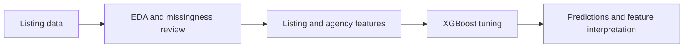

# Detecting fraudulent real estate listings with XGBoost

This repository contains my exploratory analysis, feature engineering, and XGBoost experiments from the [KUBIG Team 2 DACON project](https://github.com/KU-BIG/KUBIG_2025_SPRING/tree/main/KUBIG%20CONTEST/DL/Team2). For more information about the project, see the team repository.

## Goal

The task was to identify fraudulent real estate listings using tabular information, without visiting properties or viewing photographs. The dataset was small and imbalanced, making feature construction and validation especially important.

## My contribution

- Examined missing values and feature distributions, then created listing-age and other listing features.
- Built smoothed agency-risk features without using validation labels to construct those features during cross-validation.
- Tuned XGBoost with repeated stratified cross-validation and Optuna, then examined gain importance and SHAP values.

## Results

The team compared models using macro F1. The chart below includes my XGBoost approach alongside other team members' models and comes from the [team README](https://github.com/KU-BIG/KUBIG_2025_SPRING/tree/main/KUBIG%20CONTEST/DL/Team2).

In the team's comparison, XGBoost achieved a macro F1 score of **0.8871**, close to the highest reported score of **0.8881** (TabPFN).

## Discussion

This project highlighted the value of feature construction and careful validation for small tabular datasets. Agency history can be useful, but its risk feature must be calculated without the label of the listing being evaluated.

## Code structure

| File | Role |
| --- | --- |
| [`preprocess.py`](preprocess.py) | Missing-value and outlier handling |
| [`features.py`](features.py) | Listing and agency features |
| [`train.py`](train.py) | Cross-validation, tuning, final fit, and submission |
| [`explain.py`](explain.py) | Gain and SHAP feature importance |
| [`notebooks/preprocessed_xgboost.ipynb`](notebooks/preprocessed_xgboost.ipynb) | Original exploratory experiments |
