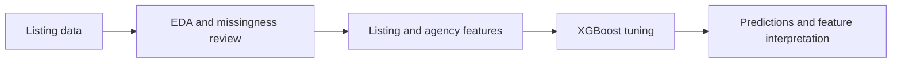

# Detecting fraudulent real estate listings with XGBoost

This repository presents my work in [KUBIG Team 2's DACON fraudulent-listing project](https://github.com/KU-BIG/KUBIG_2025_SPRING/tree/main/KUBIG%20CONTEST/DL/Team2). The team compared several machine-learning and deep-learning approaches. My part focused on exploratory analysis, feature engineering, and an XGBoost pipeline.

## Motivation

The task was to classify listings from a small tabular dataset without visiting the property or inspecting its photos. With limited labeled data, details such as missing fields, listing age, and agency history could matter as much as the choice of classifier.

## My contribution

- Examined missingness and feature distributions, then created listing-age and other listing-level features.
- Built smoothed agency-risk grades. The implementation avoids using a validation listing's label when constructing its agency feature during cross-validation.
- Tuned XGBoost with repeated stratified cross-validation and Optuna, then inspected gain importance and SHAP values.



## Results

The chart below is the **team's macro-F1 model comparison**, which includes the XGBoost approach alongside other models. It is reproduced from the [team README](https://github.com/KU-BIG/KUBIG_2025_SPRING/tree/main/KUBIG%20CONTEST/DL/Team2).


The broader team found tree-based methods competitive on this task. This repository contains my XGBoost experiments and feature pipeline, rather than all models shown in the chart.

## Discussion

The small, imbalanced dataset made preprocessing and validation choices consequential. In particular, agency history can be informative, but agency-risk features must be constructed without using the outcome of the listing being evaluated. The code separates preprocessing, feature construction, model tuning, and interpretation so those choices are easy to inspect.

## Code and usage

| File | Role |
| --- | --- |
| [`preprocess.py`](preprocess.py) | Missing-value and outlier handling |
| [`features.py`](features.py) | Listing and agency features |
| [`train.py`](train.py) | Cross-validation, tuning, final fit, and submission |
| [`explain.py`](explain.py) | Gain and SHAP feature importance |
| [`notebooks/preprocessed_xgboost.ipynb`](notebooks/preprocessed_xgboost.ipynb) | Original exploratory experiments |

Download the data from the [DACON competition](https://dacon.io/competitions/official/236439/data), install [`requirements.txt`](requirements.txt), and run:

```bash
python train.py --train data/train.csv --test data/test.csv --sample-submission data/sample_submission.csv
python explain.py --model outputs/xgboost.json --features outputs/train_features.csv
```

The competition data and trained model are not included here.
